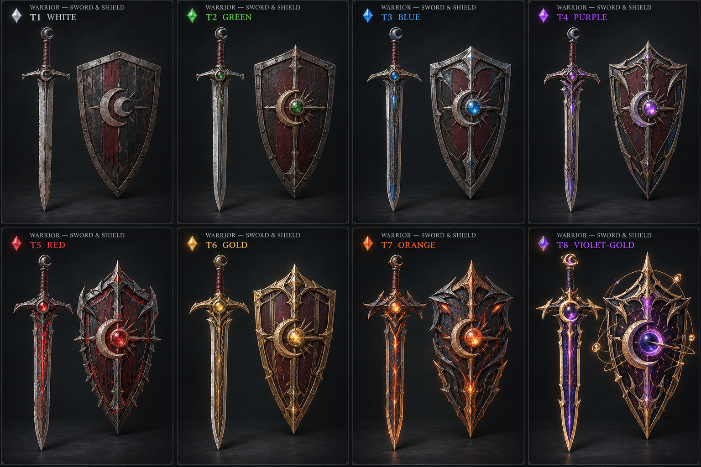
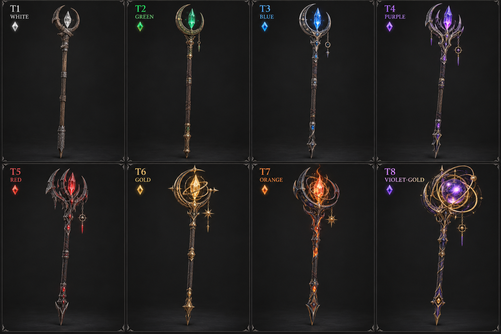
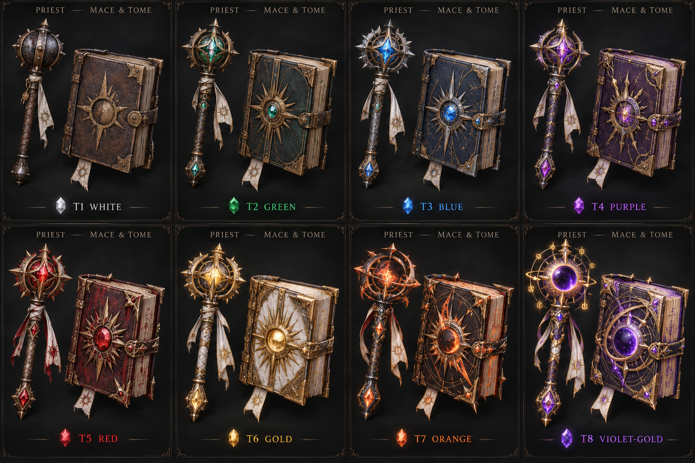
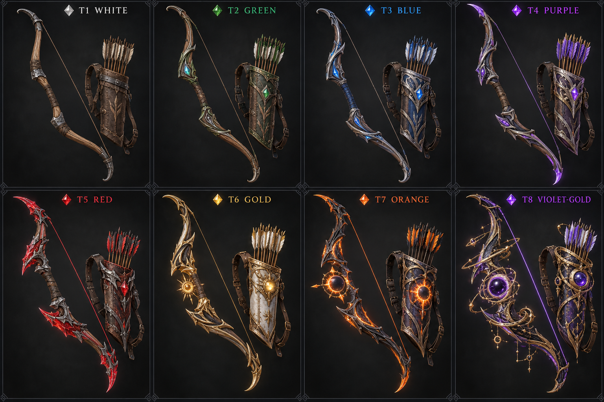
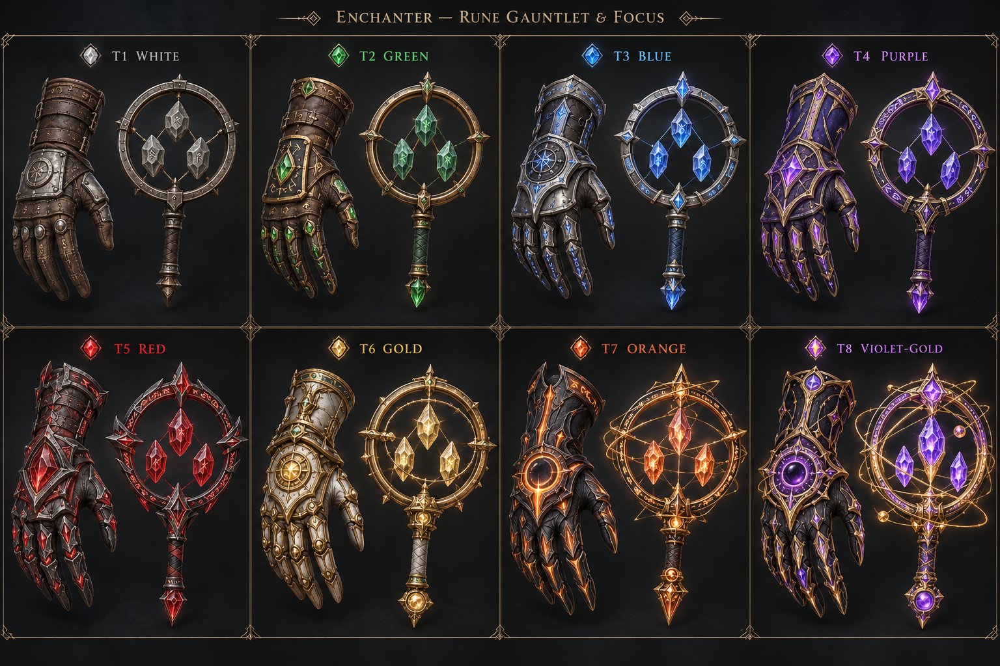

# SOULFORGE — อาวุธ 5 อาชีพ / 8 Tier

เอกสารออกแบบต้นฉบับ v1 — ภาพสร้างด้วย built-in ImageGen เป็นภาพคอนเซปต์ ไม่ใช่โมเดล 3D และยังไม่ได้ใส่ระบบนี้ในเกม ตัวเลขเป็นข้อเสนอเริ่มต้นที่ยังไม่ผ่าน playtest

## หลักการ

ใช้แนวคิด ARPG แบบไอเทมมีค่าสถานะสุ่ม ช่องอัญมณี และพลังเฉพาะที่เปลี่ยนวิธีเล่น โดยไม่อ้างว่าเป็นตารางหรือสูตรของ Diablo ลำดับสีเป็นของ SOULFORGE ตามที่ผู้ใช้กำหนด สีแดง/ส้มไม่ได้บังคับให้ดาเมจเป็นธาตุไฟ สี Tier แยกจากธาตุและ Soul-Forge

Class เริ่มต้นทั้ง 5 สามารถใช้สายอาวุธนี้ได้ แต่ Tier สูงเป็นเส้นทางความก้าวหน้าภายหลัง ไม่ใช่อุปกรณ์ที่แจกเริ่มเกม

## Tier และงบค่าสถานะ

| Tier | สี | ชื่อระดับ | ดัชนีพลังฐาน | Affix รวมชุด | รูรวมชุด | งานภาพ |
|---|---|---|---:|---:|---:|---|
| T1 | ขาว | Worn | 100 | 0 | 0 | เหล็ก/ไม้เก่า ผิวด้าน ไม่มีแสง |
| T2 | เขียว | Tempered | 115 | 1 | 0 | ขัดแต่งวัสดุ อัญมณีเขียวขนาดเล็ก |
| T3 | ฟ้า | Runebound | 135 | 2 | 1 | เหล็กสลักรูน แกนพลังฟ้า |
| T4 | ม่วง | Soulbound | 160 | 3 | 1 | โครงสร้างซ้อนชั้น คริสตัลม่วง |
| T5 | แดง | Bloodforged | 190 | 4 | 2 | รูปทรงคมและแกนแดง ลายซับซ้อน |
| T6 | ทอง | Sovereign | 225 | 5 | 2 | ทองเก่าและรูปทรงสง่างาม แสงทองควบคุม |
| T7 | ส้ม | Starfire | 265 | 6 | 3 | โลหะดำ แกนพลังส้มและโครงสร้างขั้นสูง |
| T8 | ม่วงอมทอง | Eclipse Eternal | 310 | 7 | 3 | ออบซิเดียนขอบทอง แกนคราสม่วงและรูนวงโคจรทอง |

ดัชนีพลังฐานเปรียบเทียบอาวุธอาชีพเดียวกันที่ item level 50 เท่านั้น ไม่ใช่คะแนน DPS รวมทั้งบิลด์หรือความเก่งข้ามอาชีพ พลังพิเศษไม่ถูกนับในดัชนีนี้ Tier สูงกว่าไม่รับพลังเฉพาะของ Tier ต่ำกว่ามาซ้อนอัตโนมัติ

## ช่องสวมใส่และการคำนวณ

- Warrior: ดาบ 1 มือ + โล่ 1 มือ; โล่เพิ่มเกราะ/บล็อก ไม่เพิ่ม WD และไม่มีการตีด้วยมือรองอัตโนมัติ
- Mage: คทาใช้ทั้งสองมือ ไม่มีช่องถือหนังสือหรือวงแหวนเพิ่ม; ได้ affix และช่องอัญมณีทั้งงบในคทา
- Priest: กระบอง + คัมภีร์; SP ของทั้งสองชิ้นบวกกันเพื่อคำนวณฮีลและเวท ไม่บวกดาเมจหนังสือเข้ากระบอง
- Archer: ธนูใช้ทั้งสองมือ; ซองลูกศรเป็นช่องหลังเฉพาะอาชีพและนับอยู่ในงบอุปกรณ์นี้ ไม่ได้เพิ่มงบ affix ฟรี
- Enchanter: ถุงมืออักขระขวาเป็นอาวุธมือหลัก และ focus ซ้ายเป็นมือรอง; SP บวกกัน ถุงมือนี้ไม่ใช่ชิ้นเกราะช่องมือ
- Affix ชุดคู่แบ่งมือหลัก/ชิ้นเสริม T1–T8 = 0/0, 1/0, 1/1, 2/1, 2/2, 3/2, 3/3, 4/3 ตามลำดับ
- ช่องอัญมณีชุดคู่แบ่งหลัก/เสริม = 0/0, 0/0, 1/0, 1/0, 1/1, 1/1, 2/1, 2/1; คทารับจำนวนรวมทั้งหมด
- สวมต่าง Tier กันได้: คิดค่าสถานะแต่ละชิ้นตามจริง พลังเฉพาะอยู่ที่มือหลักเท่านั้น ไม่ต้องใส่เซ็ตตรงกัน ไม่เพิ่ม affix พิเศษเพราะใส่ครบคู่

WD = ค่าเฉลี่ยดาเมจต่ำสุด–สูงสุดของมือหลักก่อนคริติคอล; SP = พลังเวทรวมของชุด; APS = จำนวนโจมตีพื้นฐาน/วินาที ไม่ใช่ความเร็วร่าย; DPS พื้นฐาน = WD × APS

ตัวเลข damage_min/max คือช่วงความเสียหายต่อครั้ง ไม่ใช่ช่วงสุ่มคุณภาพไอเทม สกิลควรใช้ coefficient คูณ WD หรือ SP ตามประเภท ห้ามนำ SP มาบวกซ้ำกับ WD โดยอัตโนมัติ เช่น สกิลดาบ 150% WD ของ T1 = 150 ก่อนค่าสถานะและการป้องกัน

SP ใช้กับสกิลเวท/ฮีล/เกราะ ส่วนดาเมจพื้นฐานของคทา กระบอง และถุงมือเป็นการโจมตีสำรอง จึงไม่ใช้ DPS พื้นฐานเทียบประสิทธิภาพฮีลหรือเวทกับ Warrior/Archer

## Warrior

อุปกรณ์: ดาบมือหลัก + โล่มือรอง

| Tier / สี | มือหลัก | ชิ้นเสริม | DMG / ครั้ง | APS | DPS พื้นฐาน | SP รวม | ค่าชิ้นเสริม |
|---|---|---|---:|---:|---:|---:|---|
| T1 ขาว | Worn Crescent Saber | Worn Hollowguard Shield | 80–120 | 1.2 | 120.0 | 0 | เกราะ 100; บล็อก 10%; ลด hit ที่บล็อก 40% |
| T2 เขียว | Tempered Crescent Saber | Tempered Hollowguard Shield | 92–138 | 1.2 | 138.0 | 0 | เกราะ 115; บล็อก 12%; ลด hit ที่บล็อก 40% |
| T3 ฟ้า | Runebound Crescent Saber | Runebound Hollowguard Shield | 108–162 | 1.2 | 162.0 | 0 | เกราะ 135; บล็อก 14%; ลด hit ที่บล็อก 40% |
| T4 ม่วง | Soulbound Crescent Saber | Soulbound Hollowguard Shield | 128–192 | 1.2 | 192.0 | 0 | เกราะ 160; บล็อก 16%; ลด hit ที่บล็อก 40% |
| T5 แดง | Bloodforged Crescent Saber | Bloodforged Hollowguard Shield | 152–228 | 1.2 | 228.0 | 0 | เกราะ 190; บล็อก 18%; ลด hit ที่บล็อก 40% |
| T6 ทอง | Sovereign Crescent Saber | Sovereign Hollowguard Shield | 180–270 | 1.2 | 270.0 | 0 | เกราะ 225; บล็อก 20%; ลด hit ที่บล็อก 40% |
| T7 ส้ม | Starfire Crescent Saber | Starfire Hollowguard Shield | 212–318 | 1.2 | 318.0 | 0 | เกราะ 265; บล็อก 22%; ลด hit ที่บล็อก 40% |
| T8 ม่วงอมทอง | Eclipse Eternal Crescent Saber | Eclipse Eternal Hollowguard Shield | 248–372 | 1.2 | 372.0 | 0 | เกราะ 310; บล็อก 24%; ลด hit ที่บล็อก 40% |

### พลังเฉพาะประจำ Tier

- **T1 ขาว:** ไม่มีพลังเฉพาะ
- **T2 เขียว:** ไม่มีพลังเฉพาะ; เริ่มสุ่ม affix
- **T3 ฟ้า:** ไม่มีพลังเฉพาะ; เพิ่มจำนวน affix
- **T4 ม่วง:** Guard Echo: เมื่อบล็อกสำเร็จ การฟันตรงครั้งถัดไปภายใน 3 วินาทีสร้างคลื่น 40% WD; คูลดาวน์ภายใน 4 วินาที
- **T5 แดง:** Crimson Riposte: เมื่อบล็อกสำเร็จ การฟันตรงครั้งถัดไปภายใน 3 วินาทีทำเลือดไหลรวม 90% WD ใน 3 วินาที; คูลดาวน์ภายใน 4 วินาที; เลือดไหลชนิดนี้ไม่ซ้อน
- **T6 ทอง:** Sovereign Guard: บล็อกสำเร็จสร้างเกราะชั่วคราว 8% Max HP นาน 4 วินาที; คูลดาวน์ภายใน 8 วินาที
- **T7 ส้ม:** Starfire Cleave: การโจมตีตรงด้วยดาบทุกครั้งที่ 4 ปล่อยคลื่น 140% WD รัศมี 3 เมตร สูงสุด 5 เป้าหมาย; คูลดาวน์ภายใน 5 วินาที
- **T8 ม่วงอมทอง:** Eclipse Counter: บล็อกสำเร็จสะสม 1 ตรา สูงสุด 3; ครบแล้วการฟันครั้งถัดไปใช้ตราทั้งหมด ปล่อยคลื่น 220% WD รัศมี 4 เมตร สูงสุด 6 เป้าหมาย พร้อมเกราะ 10% Max HP 4 วินาที; คูลดาวน์ภายใน 8 วินาที

## Mage

อุปกรณ์: คทาสองมือ กินช่องมือหลักและมือรอง

| Tier / สี | มือหลัก | ชิ้นเสริม | DMG / ครั้ง | APS | DPS พื้นฐาน | SP รวม | ค่าชิ้นเสริม |
|---|---|---|---:|---:|---:|---:|---|
| T1 ขาว | Worn Astral Cage Staff | ใช้สองมือ | 25–35 | 1.0 | 30.0 | 120 | — |
| T2 เขียว | Tempered Astral Cage Staff | ใช้สองมือ | 29–40 | 1.0 | 34.5 | 138 | — |
| T3 ฟ้า | Runebound Astral Cage Staff | ใช้สองมือ | 34–47 | 1.0 | 40.5 | 162 | — |
| T4 ม่วง | Soulbound Astral Cage Staff | ใช้สองมือ | 40–56 | 1.0 | 48.0 | 192 | — |
| T5 แดง | Bloodforged Astral Cage Staff | ใช้สองมือ | 48–66 | 1.0 | 57.0 | 228 | — |
| T6 ทอง | Sovereign Astral Cage Staff | ใช้สองมือ | 56–79 | 1.0 | 67.5 | 270 | — |
| T7 ส้ม | Starfire Astral Cage Staff | ใช้สองมือ | 66–93 | 1.0 | 79.5 | 318 | — |
| T8 ม่วงอมทอง | Eclipse Eternal Astral Cage Staff | ใช้สองมือ | 78–108 | 1.0 | 93.0 | 372 | — |

### พลังเฉพาะประจำ Tier

- **T1 ขาว:** ไม่มีพลังเฉพาะ
- **T2 เขียว:** ไม่มีพลังเฉพาะ; เริ่มสุ่ม affix
- **T3 ฟ้า:** ไม่มีพลังเฉพาะ; เพิ่มจำนวน affix
- **T4 ม่วง:** Arcane Echo: สกิลโจมตีที่ร่ายด้วยตนเองทุกครั้งที่ 5 ทำดาเมจเสริม 45% SP ต่อเป้าหมายแรก; คูลดาวน์ภายใน 4 วินาที
- **T5 แดง:** Crimson Reservoir: สกิลโจมตีที่ร่ายเองทุกครั้งที่ 4 ใช้มานาลดลง 25%; ไม่มีการคืนมานาเกินค่าที่จ่าย
- **T6 ทอง:** Sovereign Orbit: เมื่อจ่ายมานารวม 100 หน่วย สกิลโจมตีถัดไปยิงลูกเวท 3 ลูก ลูกละ 35% SP; คูลดาวน์ภายใน 6 วินาที; ไม่เก็บมานาส่วนเกินระหว่างคูลดาวน์
- **T7 ส้ม:** Starfire Convergence: สกิลโจมตีที่ร่ายเองทุกครั้งที่ 4 สร้างดาวตก 170% SP รัศมี 3 เมตร สูงสุด 5 เป้าหมาย; คูลดาวน์ภายใน 6 วินาที
- **T8 ม่วงอมทอง:** Eclipse Singularity: สกิลโจมตีที่ร่ายเองทุกครั้งที่ 5 สร้างวงคราส 4 วินาที ดึงศัตรูทั่วไปเข้าศูนย์กลางและทำรวม 260% SP รัศมี 4 เมตร สูงสุด 6 เป้าหมาย; คูลดาวน์ภายใน 10 วินาที; บอสไม่ถูกดึง

## Priest

อุปกรณ์: กระบองมือหลัก + คัมภีร์มือรอง

| Tier / สี | มือหลัก | ชิ้นเสริม | DMG / ครั้ง | APS | DPS พื้นฐาน | SP รวม | ค่าชิ้นเสริม |
|---|---|---|---:|---:|---:|---:|---|
| T1 ขาว | Worn Dawn Mace | Worn Covenant Tome | 50–70 | 1.05 | 63.0 | 100 | SP 30; ฟื้นมานา 1.0/วินาที |
| T2 เขียว | Tempered Dawn Mace | Tempered Covenant Tome | 57–80 | 1.05 | 71.9 | 114 | SP 34; ฟื้นมานา 1.4/วินาที |
| T3 ฟ้า | Runebound Dawn Mace | Runebound Covenant Tome | 68–94 | 1.05 | 85.0 | 134 | SP 40; ฟื้นมานา 1.8/วินาที |
| T4 ม่วง | Soulbound Dawn Mace | Soulbound Covenant Tome | 80–112 | 1.05 | 100.8 | 160 | SP 48; ฟื้นมานา 2.2/วินาที |
| T5 แดง | Bloodforged Dawn Mace | Bloodforged Covenant Tome | 95–133 | 1.05 | 119.7 | 190 | SP 57; ฟื้นมานา 2.6/วินาที |
| T6 ทอง | Sovereign Dawn Mace | Sovereign Covenant Tome | 112–158 | 1.05 | 141.8 | 226 | SP 68; ฟื้นมานา 3.0/วินาที |
| T7 ส้ม | Starfire Dawn Mace | Starfire Covenant Tome | 132–186 | 1.05 | 167.0 | 266 | SP 80; ฟื้นมานา 3.4/วินาที |
| T8 ม่วงอมทอง | Eclipse Eternal Dawn Mace | Eclipse Eternal Covenant Tome | 155–217 | 1.05 | 195.3 | 310 | SP 93; ฟื้นมานา 3.8/วินาที |

### พลังเฉพาะประจำ Tier

- **T1 ขาว:** ไม่มีพลังเฉพาะ
- **T2 เขียว:** ไม่มีพลังเฉพาะ; เริ่มสุ่ม affix
- **T3 ฟ้า:** ไม่มีพลังเฉพาะ; เพิ่มจำนวน affix
- **T4 ม่วง:** Mercy Echo: ฮีลตรงที่ร่ายเองทุกครั้งที่ 4 ฮีลพันธมิตรที่บาดเจ็บใกล้เป้าหมายอีก 1 คน 40% SP; คูลดาวน์ภายใน 4 วินาที
- **T5 แดง:** Crimson Vow: เมื่อฮีลตรงให้เป้าหมายที่ HP ต่ำกว่า 35% เพิ่มฮีล 65% SP; คูลดาวน์ภายใน 6 วินาทีต่อผู้ร่าย
- **T6 ทอง:** Dawn Aegis: เปลี่ยน 25% ของฮีลส่วนเกินจากฮีลตรงเป็นเกราะ สูงสุด 8% Max HP ของผู้รับ นาน 5 วินาที; ไม่สะสมกับตัวเอง
- **T7 ส้ม:** Starfire Sanctuary: ฮีลตรงที่ร่ายเองทุกครั้งที่ 4 สร้างเขต 4 วินาที ฮีลรวม 180% SP ต่อพันธมิตร สูงสุด 5 คน รัศมี 4 เมตร; คูลดาวน์ภายใน 10 วินาที
- **T8 ม่วงอมทอง:** Eclipse Benediction: ฮีลตรงที่ร่ายเองทุกครั้งที่ 5 ฮีลกลุ่ม 200% SP และเกราะ 8% Max HP ของผู้รับ 4 วินาที สูงสุด 5 คน รัศมี 4 เมตร; คูลดาวน์ภายใน 12 วินาที

## Archer

อุปกรณ์: ธนูสองมือ + ซองลูกศรช่องหลัง (ไม่ใช่มือรอง)

| Tier / สี | มือหลัก | ชิ้นเสริม | DMG / ครั้ง | APS | DPS พื้นฐาน | SP รวม | ค่าชิ้นเสริม |
|---|---|---|---:|---:|---:|---:|---|
| T1 ขาว | Worn Hollow Recurve | Worn Ranger Quiver | 90–130 | 1.1 | 121.0 | 0 | โอกาสคริติคอล +0 จุดเปอร์เซ็นต์ |
| T2 เขียว | Tempered Hollow Recurve | Tempered Ranger Quiver | 103–150 | 1.1 | 139.2 | 0 | โอกาสคริติคอล +1 จุดเปอร์เซ็นต์ |
| T3 ฟ้า | Runebound Hollow Recurve | Runebound Ranger Quiver | 122–176 | 1.1 | 163.9 | 0 | โอกาสคริติคอล +2 จุดเปอร์เซ็นต์ |
| T4 ม่วง | Soulbound Hollow Recurve | Soulbound Ranger Quiver | 144–208 | 1.1 | 193.6 | 0 | โอกาสคริติคอล +3 จุดเปอร์เซ็นต์ |
| T5 แดง | Bloodforged Hollow Recurve | Bloodforged Ranger Quiver | 171–247 | 1.1 | 229.9 | 0 | โอกาสคริติคอล +4 จุดเปอร์เซ็นต์ |
| T6 ทอง | Sovereign Hollow Recurve | Sovereign Ranger Quiver | 202–292 | 1.1 | 271.7 | 0 | โอกาสคริติคอล +5 จุดเปอร์เซ็นต์ |
| T7 ส้ม | Starfire Hollow Recurve | Starfire Ranger Quiver | 238–344 | 1.1 | 320.1 | 0 | โอกาสคริติคอล +6 จุดเปอร์เซ็นต์ |
| T8 ม่วงอมทอง | Eclipse Eternal Hollow Recurve | Eclipse Eternal Ranger Quiver | 279–403 | 1.1 | 375.1 | 0 | โอกาสคริติคอล +7 จุดเปอร์เซ็นต์ |

### พลังเฉพาะประจำ Tier

- **T1 ขาว:** ไม่มีพลังเฉพาะ
- **T2 เขียว:** ไม่มีพลังเฉพาะ; เริ่มสุ่ม affix
- **T3 ฟ้า:** ไม่มีพลังเฉพาะ; เพิ่มจำนวน affix
- **T4 ม่วง:** Piercing Thread: ลูกธนูตรงทุกครั้งที่ 4 ทะลุได้อีก 1 เป้าหมาย โดยเป้าหมายที่สองรับ 50% WD; คูลดาวน์ภายใน 3 วินาที
- **T5 แดง:** Crimson Fletching: คริติคอลจากลูกธนูตรงสร้างเลือดไหลรวม 70% WD ใน 3 วินาที; คูลดาวน์ภายใน 4 วินาที; ไม่ซ้อน
- **T6 ทอง:** Sovereign Volley: ลูกธนูตรงทุกครั้งที่ 5 ยิงลูกเพิ่ม 2 ลูก ลูกละ 45% WD ไปยังศัตรูอื่นสูงสุด 2 ตัวในระยะ 6 เมตร; คูลดาวน์ภายใน 4 วินาที
- **T7 ส้ม:** Starfire Mark: โจมตีตรงเป้าหมายเดียวครบ 4 ครั้ง ระเบิด 150% WD รัศมี 3 เมตร สูงสุด 5 เป้าหมาย; คูลดาวน์ภายใน 6 วินาที
- **T8 ม่วงอมทอง:** Eclipse Hunt: ลูกธนูตรงทุกครั้งที่ 5 สร้างลูกธนูวิญญาณ 3 ลูก ลูกละ 70% WD เลือกเป้าหมายได้ไม่ซ้ำสูงสุด 3 ตัว; ถ้ามีศัตรูตัวเดียว รวมโจมตีได้แต่ดาเมจรวมจำกัด 150% WD; คูลดาวน์ภายใน 6 วินาที

## Enchanter

อุปกรณ์: ถุงมืออักขระขวามือหลัก + วงแหวนเวทซ้ายมือรอง

| Tier / สี | มือหลัก | ชิ้นเสริม | DMG / ครั้ง | APS | DPS พื้นฐาน | SP รวม | ค่าชิ้นเสริม |
|---|---|---|---:|---:|---:|---:|---|
| T1 ขาว | Worn Inscription Gauntlet | Worn Orbit Focus | 35–45 | 1.15 | 46.0 | 110 | SP 30; ระยะเวลาดีบัฟ +0% |
| T2 เขียว | Tempered Inscription Gauntlet | Tempered Orbit Focus | 40–52 | 1.15 | 52.9 | 126 | SP 34; ระยะเวลาดีบัฟ +3% |
| T3 ฟ้า | Runebound Inscription Gauntlet | Runebound Orbit Focus | 47–61 | 1.15 | 62.1 | 148 | SP 40; ระยะเวลาดีบัฟ +6% |
| T4 ม่วง | Soulbound Inscription Gauntlet | Soulbound Orbit Focus | 56–72 | 1.15 | 73.6 | 176 | SP 48; ระยะเวลาดีบัฟ +9% |
| T5 แดง | Bloodforged Inscription Gauntlet | Bloodforged Orbit Focus | 66–86 | 1.15 | 87.4 | 209 | SP 57; ระยะเวลาดีบัฟ +12% |
| T6 ทอง | Sovereign Inscription Gauntlet | Sovereign Orbit Focus | 79–101 | 1.15 | 103.5 | 248 | SP 68; ระยะเวลาดีบัฟ +15% |
| T7 ส้ม | Starfire Inscription Gauntlet | Starfire Orbit Focus | 93–119 | 1.15 | 121.9 | 292 | SP 80; ระยะเวลาดีบัฟ +18% |
| T8 ม่วงอมทอง | Eclipse Eternal Inscription Gauntlet | Eclipse Eternal Orbit Focus | 108–140 | 1.15 | 142.6 | 341 | SP 93; ระยะเวลาดีบัฟ +21% |

### พลังเฉพาะประจำ Tier

- **T1 ขาว:** ไม่มีพลังเฉพาะ
- **T2 เขียว:** ไม่มีพลังเฉพาะ; เริ่มสุ่ม affix
- **T3 ฟ้า:** ไม่มีพลังเฉพาะ; เพิ่มจำนวน affix
- **T4 ม่วง:** Rune Echo: การร่ายบัฟตรงทุกครั้งที่ 4 เพิ่มเกราะ 35% SP แก่ผู้รับ 4 วินาที; คูลดาวน์ภายใน 4 วินาที
- **T5 แดง:** Crimson Seal: ดีบัฟตรงที่ร่ายเองทุกครั้งที่ 4 ทำให้เป้าหมายรับดาเมจเพิ่ม 6% นาน 3 วินาที; คูลดาวน์ภายใน 6 วินาที; ไม่ซ้อนกับตราชนิดเดียวกัน
- **T6 ทอง:** Sovereign Inscription: บัฟตรงที่ร่ายเองทุกครั้งที่ 4 ขยายไปยังพันธมิตรอีก 1 คน ระยะเวลา 50% ของบัฟเดิม; คูลดาวน์ภายใน 6 วินาที; ไม่คัดลอกท่าไม้ตาย
- **T7 ส้ม:** Starfire Lattice: ดีบัฟตรงที่ร่ายเองทุกครั้งที่ 4 สร้างเขต 4 วินาที ลดความเร็วเคลื่อนที่ 25% และทำรวม 140% SP สูงสุด 5 เป้าหมาย รัศมี 3 เมตร; คูลดาวน์ภายใน 8 วินาที; บอสไม่ถูกลดความเร็ว
- **T8 ม่วงอมทอง:** Eclipse Weave: การร่ายบัฟ/ดีบัฟตรงครบ 5 ครั้ง สร้างเขต 5 วินาที พันธมิตรรับดาเมจน้อยลง 10% สูงสุด 5 คน ศัตรูรับดาเมจเพิ่ม 8% สูงสุด 6 ตัว รัศมี 4 เมตร; คูลดาวน์ภายใน 12 วินาที; ออร่าเดียวกันไม่ซ้อน

## ระบบ Affix สุ่ม

สุ่มโดยไม่ซ้ำชื่อภายในชิ้นเดียว แต่ต่างชิ้นซ้ำได้ภายใต้เพดานรวม จำนวนตามตาราง Tier; ค่าที่สุ่มไม่มีผลเปลี่ยนสี Tier พลังเฉพาะตามตารางเป็นค่าคงที่ v1 แยกจาก affix และไม่กินช่อง affix

ช่วงต่อหนึ่ง affix ที่ T2: ค่าคุณสมบัติหลัก STR/INT/DEX +8–12; VIT +8–12; HP +35–50; มานา +8–12; ดาเมจประเภทสกิล +3–5%; ฮีล +3–5%; ระยะเวลาบัฟ +3–5%; ระยะเวลาดีบัฟ +3–5%; ความเร็วโจมตี/ร่าย +1–2%; ลดคูลดาวน์ +1–2%; โอกาสคริติคอล +0.5–1 จุดเปอร์เซ็นต์; ความแรงคริติคอล +3–5 จุดเปอร์เซ็นต์; โอกาสบล็อก +1–2 จุดเปอร์เซ็นต์

T2–T8 คูณช่วง affix ด้วย 1.00 / 1.15 / 1.30 / 1.50 / 1.70 / 1.90 / 2.10 ตามลำดับ; ค่าจำนวนเต็มปัดใกล้ที่สุด ค่าร้อยละเก็บ 1 ตำแหน่ง สุ่มสม่ำเสมอในช่วง ห้ามถือว่าชิ้นหนึ่งได้ทุก affix ใน pool

| อาชีพ | Pool ที่เหมาะสม |
|---|---|
| Warrior | STR, VIT, HP, ดาเมจประชิด, ความเร็วโจมตี, โอกาส/ความแรงคริติคอล; โล่เพิ่มบล็อกได้ |
| Mage | INT, มานา, ดาเมจเวท, ความเร็วร่าย, ลดคูลดาวน์, โอกาส/ความแรงคริติคอล |
| Priest | INT, VIT, มานา, ฮีล, ความเร็วร่าย, ลดคูลดาวน์, ระยะเวลาบัฟ |
| Archer | DEX, VIT, HP, ดาเมจระยะไกล, ความเร็วโจมตี, โอกาส/ความแรงคริติคอล |
| Enchanter | INT, มานา, ดาเมจเวท, ความเร็วร่าย, ลดคูลดาวน์, ระยะเวลาบัฟ/ดีบัฟ |

เพดานรวมข้อเสนอ: คริติคอล 50%; บล็อก 50%; โบนัสความเร็วโจมตี 40%; โบนัสความเร็วร่าย 40%; ลดคูลดาวน์ 30%; โบนัสระยะเวลาบัฟ/ดีบัฟ 40% โดยรวมค่าประจำชิ้นเสริมด้วย คูลดาวน์ภายในของพลังไอเทมไม่ลดตาม CDR

กฎ proc: พลังไอเทมไม่กระตุ้นพลังไอเทมอื่นหรือสะสมตัวนับตนเอง ไม่คริติคอล ไม่ได้รับโบนัสความเร็วโจมตีซ้ำ ตัวนับต่อผู้ใช้หนึ่งคน; การโจมตีพื้นที่นับหนึ่งการกด ไม่ใช่จำนวนเป้าหมาย; ออกจากต่อสู้ 10 วินาทีหรือถอดอาวุธล้างตัวนับ; สลับอาวุธไม่ล้างคูลดาวน์ภายใน

DOT ของชื่อเดียวกันต่อผู้ร่าย refresh ระยะเวลา ไม่ซ้อนชั้น; เกราะชั่วคราวชื่อเดียวกันใช้ค่าที่สูงกว่าและ refresh; เอฟเฟกต์รับดาเมจเพิ่มในกลุ่มตรา/ออร่าของ Enchanter ใช้ค่าที่สูงที่สุด ไม่คูณทับกัน; เป้าหมายหมู่เลือกใกล้สุด ส่วนฮีลเลือกผู้มีสัดส่วน HP ต่ำสุดก่อน

ช่องอัญมณี v1 ใช้ชิ้นละหนึ่งคุณสมบัติ: HP +25, มานา +8, ดาเมจสกิลประเภทหนึ่ง +2%, หรือฮีล +2%; รวมแบบบวก ไม่มีการเพิ่มตัวคูณแยกทุกช่อง ช่องสี Tier ไม่ล็อกสีอัญมณี

## การเติบโตตามเลเวลและข้อจำกัด

ค่าทั้งหมดเทียบ item level 50 ถ้าต้องทดลองกับเลเวลอื่น ให้ปรับเฉพาะ DMG, SP, เกราะ และ affix จำนวนคงที่ด้วย S(L) = (L + 10) / 60 สำหรับ L = 1–50; เปอร์เซ็นต์, APS, จำนวนช่อง, คูลดาวน์ และ coefficient ของพลังเฉพาะไม่สเกลตาม L สูตรนี้เป็น placeholder ไม่ใช่สูตรระบบปัจจุบัน

Tier สูงไม่ได้กำหนดเลเวลสวมใส่หรืออัตราดรอปในเอกสารนี้ และยังต้องทดสอบเศรษฐกิจเกม สกิลแต่ละอาชีพ DPS/HPS จริง ระยะเวลาฆ่าบอส การรอดชีวิต และ PvP ก่อนใช้งานจริง โดยเฉพาะ T8 และกลุ่มฮีล/ออร่า ไม่ควรถือว่าตัวเลขผ่านบาลานซ์แล้ว

งานส่งมอบ: 5 แผ่นภาพ, 40 ชุด progression รวมอาวุธ/ชิ้นเสริม 72 ชิ้นในเชิงแบบ, ตารางพลัง และ JSON สำหรับอ้างอิงการพัฒนา ไม่ใช่ไฟล์ mesh, texture แยก, rig หรือระบบอาวุธที่ implement แล้ว
